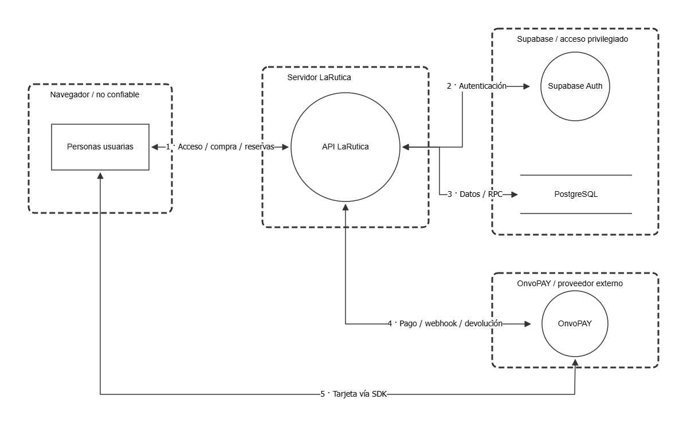

# 1.3 Modelo de amenazas con STRIDE y OWASP Threat Dragon

**Responsable:** Daniel Núñez · **Revisor:** Axel

**Estado:** En revisión · **Fecha:** 2026-11-12 · **Depende de:** 1.1

El diagrama sigue tres operaciones: **F-01** inicio de sesión y acceso por rol, **F-02** compra y pago, y **F-03** consulta y cancelación. Distingue el navegador, la API, Supabase y OnvoPAY. Los recuadros punteados marcan límites de confianza. En el flujo 5, la tarjeta pasa del navegador al SDK de Onvo; la API de LaRutica no recibe el número ni el CVV.

| ID | STRIDE / Flujo | Riesgo y prioridad | Control o verificación |
|---|---|---|---|
| T-01 | Suplantación · F-01 | **Alta.** Una cookie robada permite actuar con los permisos de la cuenta, incluso Admin. | Cookie HttpOnly/Secure en producción, hash en servidor, caducidad y revocación. Probar solicitudes sin sesión o con sesión vencida. |
| T-02 | Manipulación · F-02 | **Alta.** Alterar el pasajero, precio o moneda puede generar una reserva indebida o un cobro incorrecto. | Fijar pasajero por sesión, calcular precio en servidor y verificar el cobro en Onvo antes de confirmar. |
| T-03 | Suplantación · F-02/F-03 | **Alta.** Un webhook falso puede afectar pagos o devoluciones. | Validar el secreto, conciliar cobros en Onvo y comprobar reenvíos y devoluciones fuera de orden. |
| T-04 | Denegación de servicio · F-02 | **Media.** Retener cupos sin pagar bloquea ventas; el efecto dura hasta el vencimiento y puede repetirse. | Retención con plazo y control transaccional de capacidad; evaluar cuotas y alertas. |
| T-05 | Divulgación · F-03 | **Alta.** Un ID ajeno puede revelar contactos; una escritura indebida también puede cancelar la reserva y devolver dinero. | Validar por rol y propiedad antes de leer o escribir; probar viajeros y agencias distintos y comparar el estado persistido. |
| T-06 | Elevación de privilegios · F-01/F-03 | **Alta.** Un rol común que alcanza API Admin puede leer datos financieros o ejecutar operaciones privilegiadas. | Comprobar el rol con el perfil de servidor en cada ruta; ignorar roles enviados por el cliente. |
| T-07 | Repudio · F-02/F-03 | **Media.** Una disputa es difícil de investigar si no se pueden vincular checkout, reserva y operación de pago o devolución. | Correlacionar IDs y estados y registrar quién inició la cancelación sin almacenar datos de tarjeta. |

## Evidencia y reproducción

1. Descarga el [modelo editable](larutica-threat-dragon.json).
2. En [OWASP Threat Dragon 2](https://www.threatdragon.com/), usa una **sesión local**, abre el JSON y selecciona **Flujos críticos de LaRutica**. Selecciona un flujo o componente para ver sus amenazas.
3. En **Exportar → PNG** puedes regenerar la [imagen](larutica-diagrama.png).

Se validó el JSON con el [esquema oficial v2](https://github.com/OWASP/threat-dragon/blob/main/td.vue/src/assets/schema/threat-dragon-v2.schema.json). Se abrió el modelo en Threat Dragon 2.6.2 y se exportó el PNG desde el editor. El análisis se contrastó con las rutas de [sesiones](../../lib/supabase/session.ts), [checkout](../../app/api/checkouts/route.ts), [pago](../../lib/payments/checkout.ts) y [permisos de reservas](../../lib/reservations/policy.ts).

**Alcance:** las amenazas siguen abiertas a revisión. Enumerar un control no certifica que funcione en producción. Quedan fuera recuperación de contraseña, carga de archivos, otros servicios y verificación con Onvo real. El PR [#10](https://github.com/Dani-develop/larutica-frontend/pull/10) define los flujos; el PR [#14](https://github.com/Dani-develop/larutica-frontend/pull/14) aporta pruebas locales de autorización.

## Revisión (Axel)

- [ ] Abrió el modelo y verificó flujos y límites.
- [ ] Revisó el impacto, la prioridad y las mitigaciones.
- [ ] Observaciones resueltas.

Para la defensa: ¿dónde termina la confianza del navegador?, ¿cómo se verifica que el cobro corresponde al checkout?, ¿por qué conocer un ID no concede acceso?
